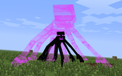

# Mutant Creatures



Mutant mini-bosses for Minecraft 1.7.10, based on [thehippomaster21's original mod](https://www.curseforge.com/minecraft/mc-mods/mutant-creatures-mod).

Adds mutant creepers, zombies, husks, skeletons, endermen, snow golems, and spider pigs, along with Chemical X, weapons, and armor. Mutant spawning and the mobs Chemical X can take can be configured.

With [Special Mobs](https://www.curseforge.com/minecraft/mc-mods/special-mobs) installed, there is also a hungry mutant zombie, made from Special Mobs' hungry zombie with Chemical X. Its belly is eaten away down to the ribs and spine. It grabs you, lifts you to its face and bites, eating the food out of your inventory to heal, and it goes after food lying on the ground. Whatever it eats falls straight out through its belly. Its roar raises Special Mobs' hungry zombies.

There is also a fire mutant zombie, made from Special Mobs' fire zombie. It is charred black with glowing lava cracks and always aflame, and fire can't hurt it. Its hits set you alight, it breathes fire at you from a few blocks away, and its roar raises Special Mobs' fire zombies. Water and rain hurt it, and while it lies dead, water finishes it off where fire won't. It spawns in the Overworld and the Nether.

[](https://github.com/AngelicIndustries/Mutant-Creatures/releases)
[](https://discord.gg/xAWCqGrguG)


## Dependencies

* [AnimationAPI](https://www.curseforge.com/minecraft/mc-mods/animationapi) 1.2.4 [](https://www.curseforge.com/minecraft/mc-mods/animationapi/files/2221721)
* [Salamander](https://github.com/AngelicIndustries/Salamander) 0.0.2 or newer [](https://www.curseforge.com/minecraft/mc-mods/salamander) [](https://67minecraft.com/mod/salamander) [](https://github.com/AngelicIndustries/Salamander/releases)
* [UniMixins](https://github.com/LegacyModdingMC/UniMixins) [](https://www.curseforge.com/minecraft/mc-mods/unimixins) [](https://github.com/LegacyModdingMC/UniMixins/releases)
* Optional: [Special Mobs](https://www.curseforge.com/minecraft/mc-mods/special-mobs) 4.2.3 [](https://www.curseforge.com/minecraft/mc-mods/special-mobs)

Install on both client and server, with Forge 10.13.4.1614.

## Building

```sh
./gradlew build
```

## Credits

* thehippomaster21 for the original Mutant Creatures and AnimationAPI
* [astryxion](https://github.com/astryxion/Mutant-Creatures) and [Omgise](https://github.com/Omgise/Mutant-Creatures) for previous forks and fixes
* The Forge and MCP teams
* [GT:NH buildscript](https://github.com/GTNewHorizons/ExampleMod1.7.10)
* A fed creeper minion's hiss is an excerpt (1.45-2.25 s) from ["Snake hissing.mp3"](https://freesound.org/people/schreibsel/sounds/540162/) by schreibsel, [CC0](https://creativecommons.org/publicdomain/zero/1.0/)

## License

[AGPLv3](LICENSE), as specified by the [original project's license](https://www.curseforge.com/minecraft/mc-mods/mutant-creatures-mod/license).

## Buy me some creatine

* [ko-fi.com](https://ko-fi.com/jackisasubtlejoke)
* Monero: `893tQ56jWt7czBsqAGPq8J5BDnYVCg2tvKpvwTcMY1LS79iDabopdxoUzNLEZtRTH4ewAcKLJ4DM4V41fvrJGHgeKArxwmJ`
